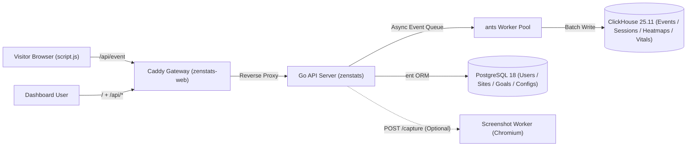

<div align="center">

<a href="https://github.com/zenstats">
  <picture>
    <source media="(prefers-color-scheme: dark)" srcset="https://raw.githubusercontent.com/zenstats/zenstats-web/main/public/logo-h-dark.svg" />
    <source media="(prefers-color-scheme: light)" srcset="https://raw.githubusercontent.com/zenstats/zenstats-web/main/public/logo-h.svg" />
    
  </picture>
</a>

<h3>Privacy-first, self-hosted web analytics — fast, visual, and completely yours.</h3>

<p>
  <a href="https://github.com/zenstats/zenstats"></a>
  <a href="https://github.com/zenstats/zenstats-web"></a>
  <a href="https://github.com/zenstats/zenstats"></a>
  <a href="https://github.com/zenstats/zenstats"></a>
  <a href="https://github.com/zenstats/zenstats-deploy/blob/main/LICENSE.md"></a>
</p>

<p>
  <a href="#features">Features</a> ·
  <a href="#repositories">Repositories</a> ·
  <a href="#quick-start">Quick Start</a> ·
  <a href="#architecture">Architecture</a> ·
  <a href="#zenstats-vs-google-analytics">Comparison</a> ·
  <a href="https://github.com/zenstats/zenstats-deploy/blob/main/docs/DEPLOY.md">Docs</a>
</p>

</div>

---

## Features

<table>
  <tr>
    <td width="50%" valign="top">
      <h4>🛡️ Privacy-First & Cookieless</h4>
      No cookies, no persistent client IDs, no cross-site tracking. Rotating daily cryptographic visitor salts, GeoIP city lookup without storing raw IPs, and automatic datacenter/bot filtering — GDPR, CCPA, and PECR ready out of the box.
    </td>
    <td width="50%" valign="top">
      <h4>⚡ Ultra-Light 256-Variant Tracker</h4>
      Core script (<code>script.js</code>) is ~6.2 KB minified (~2.6 KB gzipped). 8 modular feature flags compile into 256 on-demand variants (outbound links, file downloads, SPA hash routing, auto-capture props, optional heatmap &amp; web vitals lazy chunks).
    </td>
  </tr>
  <tr>
    <td width="50%" valign="top">
      <h4>🔥 Click &amp; Scroll Heatmaps</h4>
      Capture CSS-selector-anchored clicks (desktop, tablet, mobile) and fold/scroll-depth distributions. Includes an optional headless Chromium screenshot worker (<code>zenstats-web-screenshot</code>) for crisp multi-viewport visual overlays.
    </td>
    <td width="50%" valign="top">
      <h4>📈 Core Web Vitals Monitoring</h4>
      Lazy-loaded <code>vitals.js</code> collects real-user LCP, INP, CLS, FCP, and TTFB per page, device, and country with P50 / P75 / P95 percentile breakdowns and Good / Needs Improvement / Poor health thresholds.
    </td>
  </tr>
  <tr>
    <td width="50%" valign="top">
      <h4>🌊 User Flows &amp; Conversion Funnels</h4>
      Multi-step Sankey session path diagrams (2–4 steps from entry or custom path filters) alongside ordered conversion funnels, custom event goals, revenue tracking, and audience segments.
    </td>
    <td width="50%" valign="top">
      <h4>🧩 Custom Query v2 &amp; Pinned Views</h4>
      Flexible <code>POST /api/v2/query/:domain</code> engine supporting nested boolean &amp; behavioral filters, regex/wildcard matching, period comparisons, CSV export, and pin-to-dashboard query cards.
    </td>
  </tr>
  <tr>
    <td width="50%" valign="top">
      <h4>🔔 Operational Guardrails &amp; Sharing</h4>
      Hostname, pathname, IP, and country exclusion shields; webhook/email traffic spike &amp; drop alerts; scheduled email digest reports; password-protected shared links; multi-site RBAC sub-accounts; and GA4 CSV/ZIP import.
    </td>
    <td width="50%" valign="top">
      <h4>🐳 Self-Hosted Single-Command Deploy</h4>
      Built on Go 1.25 + PostgreSQL 18 + ClickHouse 25.11 + React 19 + Caddy. Ships as multi-arch Docker images (<code>amd64</code> / <code>arm64</code>) with Docker Compose and Kubernetes manifests.
    </td>
  </tr>
</table>

---

## ZenStats vs Google Analytics

| | **ZenStats** | **Google Analytics 4** |
|---|---|---|
| **Script Size** | **~2.6 KB** gzipped (`script.js`) | ~45 KB+ gzipped (`gtag.js`) |
| **Cookies & Consent Banners** | None required | Required in EU / UK / CA |
| **Data Ownership** | 100% yours (PostgreSQL + ClickHouse) | Google cloud servers |
| **Heatmaps & Core Web Vitals** | Built-in (`heatmap.js` + `vitals.js`) | Requires extra paid/third-party tools |
| **Ad-Blocker Resilience** | First-party Caddy proxy + custom endpoint | Blocked by most ad-blockers |
| **Pricing** | Open Source (**AGPL-3.0**) | Free tier with sampling / GA360 enterprise |

---

## Repositories

| Repository | Stack | Description |
|---|---|---|
| [**zenstats**](https://github.com/zenstats/zenstats) | Go 1.25 · Gin · ent · ClickHouse | Core API backend, high-throughput event pipeline, session aggregation, stats engine v1/v2, heatmaps, vitals, and cron jobs |
| [**zenstats-web**](https://github.com/zenstats/zenstats-web) | React 19 · TypeScript · Tailwind v4 · shadcn/ui · Recharts | Admin dashboard, interactive charts, Sankey flows, heatmap viewer, in-app docs, 256-variant Tracker SDK, and Caddy gateway |
| [**zenstats-deploy**](https://github.com/zenstats/zenstats-deploy) | Docker Compose · Kubernetes · ClickHouse config | Production, local dev, test, and heatmap screenshot deployment stacks + architecture & ops documentation |

---

## Quick Start

### Production (Docker Compose)

```bash
git clone https://github.com/zenstats/zenstats-deploy.git
cd zenstats-deploy
cp .env.example .env
# Set ZENSTATS_DOMAIN, ZENSTATS_SECRET_KEY (openssl rand -base64 32), DB_PASSWORD
docker compose up -d
```

<details>
<summary>Optional overlays: Click Heatmap Screenshot Worker &amp; Local Development</summary>

#### Enable Heatmap Auto-Screenshot Worker

```bash
# Configure HEATMAP_SCREENSHOT_TOKEN in .env, then start with the heatmap overlay:
docker compose -f docker-compose.yml -f docker-compose.heatmap.yml up -d
```

#### Local Development (Go Backend + Databases)

```bash
git clone https://github.com/zenstats/zenstats-deploy.git
git clone https://github.com/zenstats/zenstats.git
git clone https://github.com/zenstats/zenstats-web.git

cd zenstats-deploy
make db-up          # Start PostgreSQL 18 + ClickHouse 25.11

cd ../zenstats
make run            # Run Go API server on :8080

cd ../zenstats-web
pnpm install && pnpm dev   # Vite dev server on :5173
```

</details>

> See the [Deployment Guide](https://github.com/zenstats/zenstats-deploy/blob/main/docs/DEPLOY.md) for TLS, reverse proxy, ClickHouse tuning, and Kubernetes setup.

---

## Architecture



---

## Community & Security

- 🐛 [Report a Bug](https://github.com/zenstats/.github/issues/new?template=bug_report.md) · 💡 [Request a Feature](https://github.com/zenstats/.github/issues/new?template=feature_request.md) · 💬 [GitHub Discussions](https://github.com/zenstats/zenstats/discussions)
- 🤝 Read our [Contributing Guide](https://github.com/zenstats/.github/blob/main/CONTRIBUTING.md) before opening a pull request
- 🔒 Report vulnerabilities privately via our [Security Policy](https://github.com/zenstats/.github/blob/main/SECURITY.md)

<div align="center">
<sub>Licensed under <strong>AGPL-3.0</strong> · Built with care for privacy-respecting web analytics.</sub>
</div>
